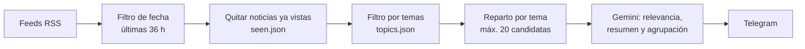
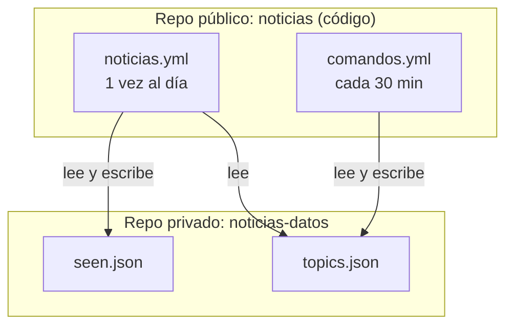

# Agente de noticias personalizado

Un agente que cada mañana lee noticias de varios medios, se queda con las que encajan con los temas de interés, las resume con un LLM y las manda por Telegram. Además, el mismo bot atiende comandos para consultar noticias o cambiar los temas cuando quiero.

Funciona sin servidor propio: todo se ejecuta en **GitHub Actions** y el uso de la API del LLM cabe en el **plan gratuito** de Gemini.

## Ejemplo

<!-- Para añadir la captura: guarda la imagen como docs/captura-telegram.png -->


*Resumen diario recibido por Telegram: titular, resumen de dos frases, fuente y enlace. Si la misma noticia sale en varios medios.*

## Qué hace

- **Resumen diario automático** a primera hora de la mañana, con hasta 12 noticias.
- **Filtra por los temas** (Celta, baloncesto, videojuegos, Lugo...) con palabras clave configurables.
- **No repite noticias** entre días y **agrupa las repetidas** entre medios.
- **Comandos de Telegram** para consultar y configurar el bot desde el móvil.
- **Datos personales en un repo privado**, separados del código, que es público.

## Cómo funciona



1. **Lectura**: se descargan los feeds RSS definidos en `feeds.json` (prensa general, deportes, tecnología, videojuegos y prensa local). Cada noticia lleva su categoría y su fecha.
2. **Fecha**: solo se consideran las últimas 36 horas. Las noticias sin fecha se descartan.
3. **Duplicados entre días**: se descartan las URLs que ya aparecen en `seen.json`.
4. **Temas**: filtro barato por palabras clave, sin tildes ni mayúsculas, con tolerancia a plurales. Una coincidencia en el titular pesa más que una en el extracto.
5. **Equilibrio**: máximo 6 noticias por tema y 20 en total, para que un tema muy activo (por ejemplo, el Celta) no ocupe todo el cupo.
6. **LLM**: una única llamada a Gemini devuelve, por cada candidata, una relevancia de 1 a 10, un resumen de dos frases y un identificador de grupo para detectar la misma noticia en medios distintos. Se envían las que puntúan 6 o más.
7. **Envío**: el resumen se manda por Telegram, troceado si supera el límite de caracteres del mensaje, y las noticias evaluadas se guardan como vistas.

## Comandos de Telegram

| Comando | Qué hace |
|---|---|
| `/ayuda` | Lista los comandos |
| `/temas` | Muestra los temas y sus palabras clave |
| `/añadir tema: palabra1, palabra2` | Añade palabras a un tema (lo crea si no existe) |
| `/quitar tema` | Borra el tema entero |
| `/quitar tema: palabra` | Quita solo esa palabra del tema |
| `/buscar texto` | Busca en todas las noticias recientes |
| `/tecnologia`, `/videojuegos`, `/deporte` | Últimas noticias de esa categoría; con texto, filtra por él (`/deporte barcelona`) |

Las consultas no usan el LLM ni tocan `seen.json`: devuelven titular, extracto y enlace de las últimas 72 horas. El bot solo responde al chat con el ID; los mensajes de cualquier otra persona se ignoran.

## Arquitectura

El código vive en un repositorio público y los datos personales (`topics.json` y `seen.json`) en uno privado, al que los workflows acceden con un token limitado a ese único repo.



- **`noticias.yml`**: se ejecuta una vez al día, envía el resumen y guarda `seen.json` en el repo de datos.
- **`comandos.yml`**: se ejecuta cada media hora, lee los mensajes pendientes del bot con `getUpdates`, los responde y guarda los cambios de `topics.json`.

No hay un proceso siempre encendido: cada ejecución atiende lo que haya llegado y termina.

## Estructura del proyecto

```
.
├── main.py          # Flujo del resumen diario (python main.py --enviar)
├── bot.py           # Atiende comandos de Telegram (--una-vez / --bucle)
├── comandos.py      # Lógica de cada comando
├── noticias.py      # Descarga y normaliza los feeds RSS
├── temas.py         # Temas, normalización de texto y filtro por palabras clave
├── seleccion.py     # Filtro de fecha, noticias vistas y reparto por tema
├── resumidor.py     # Prompt y procesado de la respuesta del LLM
├── llm.py           # Llamada a Gemini (único archivo que depende del proveedor)
├── mensaje.py       # Formato y troceado de mensajes
├── utils.py         # Envío de mensajes a Telegram
├── feeds.json       # Fuentes RSS y su categoría
├── requirements.txt
└── .github/workflows/
    ├── noticias.yml
    └── comandos.yml
```

## Instalación en local

Requisitos: Python 3.12, un bot de Telegram (creado con [@BotFather](https://t.me/BotFather)) y una clave de la API de Gemini (Google AI Studio).

```bash
git clone https://github.com/donatocotardo/noticias.git
cd noticias
python -m venv .venv
.venv\Scripts\activate        # Windows  (Linux/Mac: source .venv/bin/activate)
pip install -r requirements.txt
```

Crea un archivo `.env` con:

```
TELEGRAM_TOKEN=...
TELEGRAM_CHAT_ID=...
GEMINI_API_KEY=...
GEMINI_MODEL=...          # un modelo Flash con capa gratuita
DATOS_DIR=...             # carpeta con topics.json y seen.json (por defecto, la actual)
```

Y un `topics.json` con tus temas:

```json
{
  "Celta": ["celta", "balaidos", "iago aspas"],
  "Baloncesto": ["baloncesto", "acb", "nba"]
}
```

Comandos útiles:

```bash
python noticias.py           # comprueba que los feeds se descargan
python temas.py              # noticias que encajan con tus temas
python main.py               # prueba completa: no envía ni guarda nada
python main.py --enviar      # envía por Telegram y marca las noticias como vistas
python bot.py --bucle        # escucha comandos en tu PC, respuesta instantánea
```

> No ejecutes `bot.py --bucle` mientras el workflow de comandos esté activo: los dos se reparten los mensajes pendientes y algunos comandos se pierden.

## Despliegue en GitHub Actions

1. Crea un repositorio **privado** para los datos (por ejemplo `noticias-datos`) con `topics.json` en la raíz.
2. Genera un *fine-grained personal access token* con acceso **solo a ese repo** y el permiso *Contents: Read and write*.
3. En el repo del código, añade estos *secrets* (Settings → Secrets and variables → Actions):

   | Secreto | Contenido |
   |---|---|
   | `TELEGRAM_TOKEN` | Token del bot |
   | `TELEGRAM_CHAT_ID` | Tu ID de chat |
   | `GEMINI_API_KEY` | Clave de Gemini |
   | `GEMINI_MODEL` | Nombre del modelo |
   | `DATOS_REPO` | `usuario/nombre-del-repo-de-datos` |
   | `DATOS_TOKEN` | El token del paso 2 |

4. Sube los workflows y lanza cada uno una vez a mano desde la pestaña **Actions → Run workflow** para comprobar que funcionan.

A partir de ahí se ejecutan solos: el resumen a la hora que quieras.

Se puede guardar `topics.json` y `seen.json` en el propio repo y así no tener que crear otro repositorio privado ni token.